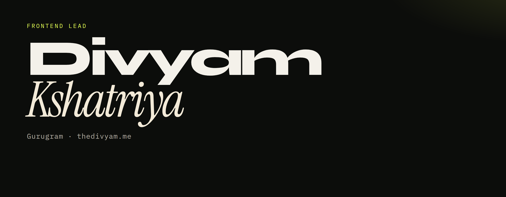

I lead frontend for the Ministry of Industry and Mineral Resources. The work is the architecture under the interface: Next.js, React, and React Native, shaped so a growing product still feels like one product.

TypeScript · React · Next.js · React Native

[thedivyam.me](https://thedivyam.me) · [LinkedIn](https://www.linkedin.com/in/divyam16)

## Now

**Lead Software Engineer** at the Ministry of Industry and Mineral Resources, since July 2024. I set how the interface is built: the component model across web and mobile, and the standards the team keeps once more than one person is in the codebase.

Based in Gurugram, India.

## What I stay close to

**Architecture.** Component boundaries, shared language in the codebase, and decisions that still make sense when a second team joins the product.

**Web.** Next.js and React for interfaces that have to stay fast and legible as the surface area grows. Types carry the contract.

**Mobile.** React Native when the same product has to feel considered in someone’s hand.

## Where the work has been

**2024 — Now** · Lead Software Engineer, Ministry of Industry and Mineral Resources

**2021 — 2024** · Software Developer, Impulsive Web, Noida. SDE1, then SDE2.

**2021** · React Developer, Digia Tech, Gurugram

**2019 — 2021** · React Developer, immersifAI, Sydney

**2018 — 2021** · B. Information Technology, Western Sydney University. Dean’s Merit List, 2018–19 and 2019–20.

The longer page is [thedivyam.me](https://thedivyam.me).
